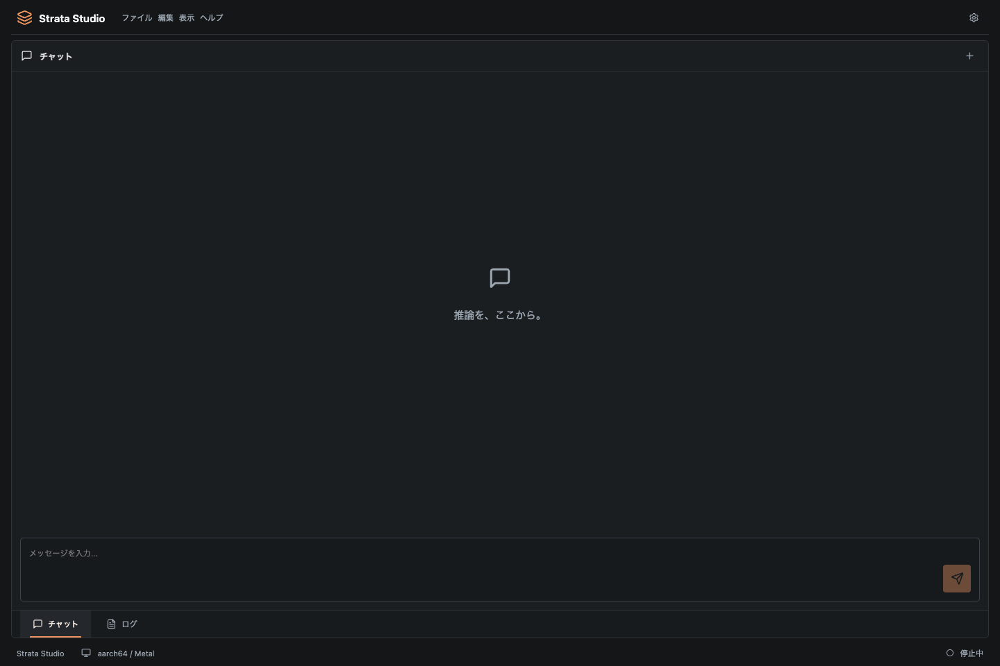

# Soliton

0.1.3では、API単独利用でもRust側でエンジン起動中にCPUトークナイザーを準備します。状態取得なしの4回の比較で初回受付の中央値は298msから5msでした。初期化を前倒しする改善であり、GPUの高速化ではありません。[結果と範囲](docs/INFERENCE.md#autonomous-startup-prewarm--2026-11-08)と[変更履歴](CHANGELOG.md)を参照してください。



[English](README.md) · [简体中文](README.zh-CN.md)

ローカル推論・知識編集実験・OpenAIによる編集計画作成を行う、Apple Silicon向けTauri 2アプリです。Rust APIゲートウェイはStrataとvLLM-Appleに対応します。会話・履歴・ログ・計測はRustで共有し、推論エンジンを手動で切り替えます。

## 知識ラボ

上部の「推論 / 知識ラボ」で画面を切り替えます。知識ラボの「編集 / 評価 / 履歴」から、別のLoRA／QLoRAアダプターを作成し、元モデルと比較できます。英語・日本語・简体中文に対応し、下書き・計画・ジョブ・履歴はRustでウインドウ間に共有します。

### OpenAIで編集計画を作成する

1. 「知識ラボ → 編集 → OpenAI 編集プランナー」を開きます。下書きの変更は先に保存してください。
2. 編集の目的と根拠資料を入力します。周辺知識の評価に使う、編集対象と無関係の確認済み事実も含めてください。編集フォームで「追加・修正」または「回答を抑制」を選びます。
3. プランナーにOpenAI APIキーを入力するか、Rustサーバーの環境変数 `OPENAI_API_KEY` を設定します。デスクトップ版も、起動時にこの環境変数を引き継ぐ必要があります。Solitonのローカル通信用セッションAPIキーとは別のキーです。入力したキーは保存しません。
4. Structured Outputsに対応するOpenAIモデルを指定し、「計画・学習データを生成」を押します。初期値は `gpt-4.1` で、利用可否はAPIプロジェクトによります。
5. 計画・リスク・4〜12件の学習例・6〜12件の独立した評価質問を確認し、「確認して下書きへ取り込む」を押します。ローカルモデル・Python・学習設定は保持され、この操作だけでは学習を開始しません。

入力した目的・根拠資料・編集操作・言語をOpenAIに送信し、API利用料金が発生します。ローカルの重み・モデルパス・会話は送信対象に含めません。生成された事実は出典を確認してください。元の生成案・根拠資料・生成モデルは、取り込んだ下書きから実験レポートまで保存します。古い下書きに対する取り込み、学習と評価の質問重複、必須・禁止語句の矛盾は拒否します。

### ローカルで学習・比較する

設定・トークナイザー・Safetensors重みを含むローカルMLXモデルフォルダーと、MLX-LMの学習機能を備えたPythonを絶対パスで指定します。知識ラボ用の学習環境は別途準備が必要です。Strata推論用の同梱環境とは対応範囲が異なります。

推論エンジンを停止して「学習・評価」を実行すると、元モデルの評価 → LoRA／QLoRA学習 → 保存アダプターの再読込 → 編集後の評価を行います。対象知識・言い換え・間接質問・周辺知識を比較します。候補の全問と元モデルの周辺知識テストが合格した場合にアダプターを保持できます。新しい評価は完全一致を既定とし、許容する別表記と言語を指定できます。部分一致も選択できます。空回答・出力上限・禁止語句は不合格にし、判定理由と規則の版をレポートに残します。規則による判定なので意味も確認してください。旧レポートを新たに保持するには現行版で再実行が必要です。

「回答を抑制」は拒否回答を学習する機能で、知識の完全消去を証明するものではありません。元の重みは保持し、状態ファイル隣の `.soliton-knowledge/<実験ID>/` に実験条件・アダプター・レポートを保存します。「保持」は合格候補の記録で、通常の推論エンジンへの適用は未実装です。GGUFでの学習、自動編集、ROME／MEMIT、真のunlearning、重みヒートマップも未実装です。

### 検証状況

- 🟢 [Done] ローカル学習・比較・中止・履歴・レポート出力。実Gemma 2 2B 4bitでの小規模な追加／回答抑制試験では、それぞれ候補の3問に合格しました。
- 🟢 [Done] OpenAI計画画面・構造化応答の解析・根拠と生成案の保存・下書きの更新競合検査。関連Rustテスト11件、フロントエンドビルド、Tauriコンパイルが通過し、疑似HTTPの成功・認証エラーを確認しています。
- ⭕️ [Pending] 実OpenAI APIでの生成確認は、開発環境のキー未設定により保留中です。小規模なローカル試験は、広範な編集品質や完全削除の保証ではありません。

[詳細な手順・制約・データの流れ](docs/KNOWLEDGE_LAB.md) · [ロードマップ](docs/ROADMAP.md)

## エンジンの切り替え

「環境設定 → エンジン → 推論エンジン」でStrata／vLLM-Appleを選びます。現在の管理対象エンジンと子プロセスを停止してから選択を保存します。選択後に「起動」を押してください。チャット・API応答・モデル準備の実行中は切り替えできません。管理対象エンジンは同時常駐しません。別途手動起動したエンジンは管理対象外なので、先に停止してください。

vLLM-Appleでは、ルートの`vLLM-apple/`、Pythonの絶対パス、既存のローカルモデルディレクトリの絶対パス、MLX LM／vLLM-Metal、バックエンド実行ファイルの絶対パスを設定します。互換環境はvLLM-Apple側で準備してください。配布版のStrataにはPythonと依存ライブラリを同梱します。vLLM-Appleは別の互換環境を使用します。ローカルモデル画面からHugging Face URLで取得でき、エンジンの互換性は別途検査します。移動した仮想環境の実行ファイルには旧パスが残る場合があるため、必要に応じて環境を修復・再作成してください。MLXのモデル名は`default_model`、vLLM-Metalは指定したモデルパスを使います。daemonの`inference_ready`を確認してチャットを有効にします。

会話・履歴・ログ・メモリ推移・リクエスト計測は共通です。新規計測には使用エンジンも記録します。切り替え後は会話を新しいプロンプトとして送信し、KVキャッシュは引き継ぎません。各モデルのコンテキスト・role・toolsの対応制約は残ります。OpenAI APIを転送し、Anthropic `/v1/messages`はStrata選択時のみ案内します。vLLM-Apple向けの形式変換は行いません。

製品名はSoliton、bundle IDは`dev.soliton.desktop`です。新しい保存先にデータがない場合、旧`dev.strata.studio/studio.json`を読み込み、その後は新しい保存先へ保存します。元データは変更しません。独立サーバーの`.studio-state.json`と既存の`STUDIO_*`環境変数は互換性のため維持します。作業フォルダー名とエンジン名は変更しません。

`npm run build`・`cargo build -p studio-server`後に`npm run test:engines`で専用ポート18080の接続fixtureを検証できます。重み・GPUは使いません。必要に応じて`PLAYWRIGHT_CHROMIUM_EXECUTABLE`を指定してください。実モデル品質・メモリピーク・長時間性能は別途検証が必要です。

ルートの`vLLM-apple/`は独立したGitリポジトリとして維持し、親リポジトリでは二重登録を防ぐため除外します。別の環境では`git clone https://github.com/matsushibadenki/vLLM-apple.git vLLM-apple`で配置し、対応環境を準備してください。ソース変更・既存の評価記録はvLLM-apple側のGitで管理します。

## 起動

```sh
npm ci
npm run desktop
```

アプリが`127.0.0.1:8080`のAPIサーバーを起動します。独立サーバーとの同時起動はできません。

ブラウザーまたはヘッドレスで使用する場合：

```sh
npm run build
cargo run -p studio-server --release
```

`http://127.0.0.1:8080`を開きます。

## Strataの接続

ロゴ →「環境設定…」→「エンジン」でStrataディレクトリ、依存パッケージが入ったPython 3.10以上の絶対パス、Strataセットアップで生成した`strata-*.json`を指定し、「起動」を押します。初回はStrata内の`.venv/bin/python`と既存の設定ファイルを検出します。

モデルなしで接続を検証する場合は「テストエンジン」を選びます。応答とログの速度はmockエンジンの値で、実推論の性能ではありません。

実推論にはMetalエンジンのビルド、モデル、トークナイザーが必要です。[StrataのMac手順](Strata/docs/MAC.md)を参照してください。環境設定の「エンジン」タブにあるダウンロードアイコンから、接続診断・既存設定の選択・モデル準備を行えます。容量を確認してチェックを入れ、「モデルを準備」を押した場合のみ取得を開始します。準備は専用の`.venv`で実行し、ログ表示・中断・完了後の設定反映に対応しています。推論エンジンは自動起動しません。Studioから巨大モデルを自動ダウンロードすることはありません。32GiBの開発Macでは、Strata標準のSSDストリーミングとメモリ保護を維持します。

Apple Siliconでは、メモリ容量に応じてコンテキストとプロンプト用バッファを自動設定します。準備・再準備後と起動前に再適用し、既存の小さい上限は維持します。32 GiBでは8K・処理単位64を使用します。[自動メモリ設定](docs/MAC_MEMORY.md)を参照してください。 環境設定 → エンジンで自動値・適用値を確認し、「手動」でコンテキスト長・処理単位・macOS用予約メモリを変更できます。起動中でも「適用して再起動」で停止・保存・起動をまとめて実行できます。「適用」は停止中の保存用です。再準備後も値を維持します。 エンジンタブにはMac全体の使用中・空きメモリと変更前との差分もリアルタイム表示します。回収可能なキャッシュや他のアプリも含む値です。 Mac全体とStrata単体の推移を2・5・10分のグラフで表示し、設定適用・起動停止・推論区間を重ねて確認できます。履歴はチャット表示中も記録し、アプリ終了時にリセットします。

ロゴをクリックすると「アプリ情報・環境設定・終了」を表示します。上部にはファイル・編集・表示・ヘルプメニューを配置し、会話のJSON書き出し、テキスト編集、表示切り替えに対応しています。環境設定は「一般（言語）・エンジン・API」のタブで切り替えます。上部の「推論 / 知識ラボ」で画面を切り替え、「推論」内では下部の「チャット／ログ」タブを使います。`⌘,`で環境設定、`⌘N`で新しい会話、`⌘1`／`⌘2`でチャット／ログを開きます。

各パス欄のフォルダーアイコンで、ディレクトリ・設定ファイル・Pythonを選べます。会話・設定・生成中の文章はRustが所有し、再起動後も会話と設定を保存します。ワークスペースのタブ順と選択も保存します。未送信の入力文は一時的な操作状態です。書き出し先はネイティブの保存ダイアログで選びます。

## ローカルモデルの検出

「環境設定 → エンジン → ローカルモデル」（フォルダー検索アイコン）を開くとスキャンします。「モデルを準備」の画面からも開けます。Strata標準・LM Studio・Unsloth Studio・Ollama・ユーザー指定フォルダーが対象です。LM Studioの変更済み保存先、UnslothのHFキャッシュ設定と履歴、`HF_HOME`／`HF_HUB_CACHE`、`OLLAMA_MODELS`も参照します。

ユーザー指定フォルダーはパス入力またはMacのフォルダー選択で追加し、最大32件を保存します。「除外」は検索先の登録だけを取り除き、ファイルは変更しません。保存元・容量・形式・パスを表示し、保存元や名前で絞り込めます。Ollamaの拡張子のないGGUFはmanifestから名前を復元し、HFキャッシュのシンボリックリンクや同じ実体のファイルは重複をまとめます。

検出はモデルの起動互換性を保証しません。アーキテクチャ・量子化・分割ファイルの完全性は未検証で、起動には対応するStrata設定が必要です。スキャン自体はモデルを変更しません。検索先の未検出・読み取り不可・上限到達を表示します。上限は10万エントリ・2,000ファイル・深さ16・探索予算15秒です。大きな保存先はサブフォルダーを指定してください。

`GET /studio/models`で認証付きの一覧を取得し、`?refresh=true`で再スキャンします。通常の結果は30秒キャッシュします。`npm run test:models`で画面を、Rustテストで5種類の保存先・設定変更・重複と循環リンク・旧設定との互換性を検証できます。保存先の参照元は[英語版README](README.md#local-model-discovery)に記載しています。

## 検出したモデルを使用する

一覧の選択ボタンで確認し、「Strataで使用」を押します。使用できる既存のStrata設定がある場合は、その設定を適用します。それ以外は、現行Metal版が対応するQwen3.8-Flash-Next GSQ-RCOのQ2_0・IQ3_XXS・IQ3_S、UnslothのUD-Q4_K_XL・UD-Q5_K_XL・UD-Q6_K_XLを、元のファイル名で全分割ファイルが揃っている場合に準備できます。

選択時にアーキテクチャ、分割番号・個数、テンソルの重複・不足とファイル範囲を検査し、不足・破損・非対応の場合は準備を拒否します。既存ファイルへリンクして準備し、モデル本体は再ダウンロードしません。他アプリのモデルや完了マーカーは変更しません。ツール・Python依存パッケージの取得、エンジンのビルド、パック・再配置ファイル用の追加容量は必要になる場合があります。任意のMTPモデル取得は無効にしています。

準備のログ・中断・完了後の設定反映に対応しています。再利用準備に失敗してもモデル取得へ切り替えません。エンジンは「起動」で開始します。`npm run test:reuse`は小さなGGUFと偽セットアップで一連の操作を確認し、Rustテストはファイルの再利用・元ファイルの不変・モデル取得の拒否も確認します。大容量の実モデルでのビルド・推論は未検証です。

## APIとビルド

環境設定の「API」タブにある「セッションAPIキー」をコピーし、`Authorization: Bearer`または`x-api-key`で送ります。OpenAIは`/v1/chat/completions`、Anthropicは`/v1/messages`です。キーはアプリ起動ごとに更新されます。

```sh
npm run desktop:build -- --bundles app --no-sign
```

Apple Silicon向けReleaseビルドです。配布時の署名・公証にはAppleの配布用資格情報が必要です。

詳細は[English README](README.md)、[構造](docs/ARCHITECTURE.md)、[ロードマップ](docs/ROADMAP.md)を参照してください。

会話は自動保存され、ツールバーの履歴アイコンから検索・再開できます。新しい会話を始めても以前の会話は残ります。不要な会話は確認して削除でき、選択中の会話はファイルメニューからJSONで書き出せます。

環境設定 → 一般で、会話・入力欄の文字サイズ（12〜32px）とライト／ダークモードを変更できます。設定は自動保存され、再起動後も維持します。

回答の「推論の内容」と計測行から、モデルが返した推論文・ツール引数・リクエスト単位の時間やトークン数を確認できます。環境設定 → APIには直近100件の計測一覧を表示します。未取得の速度などは「—」。詳しくは[推論内容と計測](docs/INFERENCE.md)を参照してください。

下部タブはドラッグ・左右ボタン・Alt+←/→で並べ替えられます。外向き矢印でチャット／ログのグループを別ウインドウに切り離し、戻すボタンまたはウインドウを閉じる操作でメインへ戻します。順序と選択はRust側で共有・保存します。詳細は[ワークスペース操作](docs/WORKSPACE.md)を参照してください。

ドッキング配置アイコンから、チャットとログを左右・上下の独立グループに分割し、再結合できます。タブを辺や中央のターゲットへドラッグしても操作でき、境界のサイズ変更とグループごとのフローティングに対応します。分割配置は再起動後も復元し、狭い幅では縦に表示します。フローティング中のタブも、メイン画面や別のフローティングウインドウへ直接ドロップできます。辺で分割、中央で結合し、結合先のウインドウを維持して空になった移動元を閉じます。

## 推論の計測

既存モデルを設定した状態で `npm run benchmark:inference -- --start --output /tmp/strata-benchmark.json` を実行すると、合成データの入力を段階的に長くして、エンジンが報告するトークン数・時間とMac／エンジンのメモリ推移を記録します。モデルの取得や会話・設定の変更は行わず、この操作で起動したエンジンは終了時に停止します。[計測手順と制約](docs/BENCHMARKS.md)を参照してください。

Strata 0.2.1系の `9de04cd4`（ソース版0.1.46.3）に対応しました。[互換性と検証範囲](docs/UPSTREAM_COMPATIBILITY.md)を参照してください。

[vLLM-Appleの証跡検証と実モデル試験](docs/VLLM_APPLE.md)。

現在のGemma 2 2Bは、既存のidentity-bound証跡を使ってSoliton.appで実推論を確認済みです。対象環境と7日ごとの証跡更新手順は上記を参照してください。

現在のStrataソースは0.2.9、Tauriは2.12.5です。[依存更新と検証範囲](docs/DEPENDENCY_UPDATE_20261026.md)を参照してください。一時設定での認証付き実推論は確認済みですが、保存済み設定の旧パス移行は残っています。

最新の更新：[2026-10-26の依存移行と実推論の検証範囲](docs/DEPENDENCY_UPDATE_20261026.md)。

最新の依存更新：[2026-10-29のバージョン・互換修正・検証範囲](docs/DEPENDENCY_UPDATE_20261029.md)。

## Gemma 3のテキスト推論（MLX）

外部vLLM-Appleエンジンに`gemma3_text`の構造判定を追加しました。開発Macでは`google/gemma-3-1b-it`とMLX-LM 0.32.0を、コンテキスト512・同時実行1で検証しています。環境設定 → エンジンでvLLM-Apple／MLX LM、取得先モデルフォルダー、対応する検証証跡JSONを指定して診断・起動します。今回の短いチャットでは環境設定 → APIの最大トークンを64に設定しました。別Macや実装更新後は、その環境で証跡を再生成してください。[手順と検証記録](docs/DEPLOYMENT.ja.md)を参照してください。


## 同梱StrataでGemma 3 1Bを使用

Apple Silicon配布版では、ローカルモデル画面で取得済みの`google/gemma-3-1b-it/model.safetensors`を選び「Strataで使用」を押します。同梱PythonでF16 GGUFへ変換し、Strata選択内の専用llama.cpp Metalバックエンドで実行します。MLX・システムPython・開発ツールは不要です。元の重みは変更せず、変換用に2.5 GB以上の空き容量が必要です。対象はGemma 3 1Bのテキスト構成、コンテキスト2048・同時実行1です。既存Qwen用Strataカーネルとは別経路であり、画像入力や他サイズのGemmaは含みません。[配布手順と実機検証](docs/DEPLOYMENT.ja.md)を参照してください。


配布前検査は`npm run check:distribution -- --smoke`、検査付きZIP作成は`npm run package:validation`で実行します。[別Mac向け検証手順（三言語）](docs/CLEAN_MAC_VALIDATION.md)を用意しています。別Macの実機検証は保留中です。

最新の更新：[2026-11-02の依存・配布コミット固定・実推論検証](docs/DEPENDENCY_UPDATE_20261102.md)。


環境設定 → エンジンで任意の **MLX SSD** を選べます。Rustが起動・停止を管理し、構成と一致する専用の30分資格証跡を検査します。確認済みのGemma 2 2B構成はテキスト専用、入出力合計512、出力最大128、同時実行1件です。[設定・資格確認・制限](docs/SSD_PREFIX_CACHE.md#managed-soliton-engine-and-requalification)を参照してください。

MLX SSDにはボリューム識別に対応したv2証跡が必要です。v1証跡は自動移行せず、30分の再資格確認を行います。[照合方式と再資格確認](docs/SSD_PREFIX_CACHE.md#volume-bound-qualification-v2--2026-11-08)を参照してください。

MLX SSDの環境設定では保存領域の使用量を確認し、停止中に容量枠の75%まで整理できます。不明なファイルは保護します。
