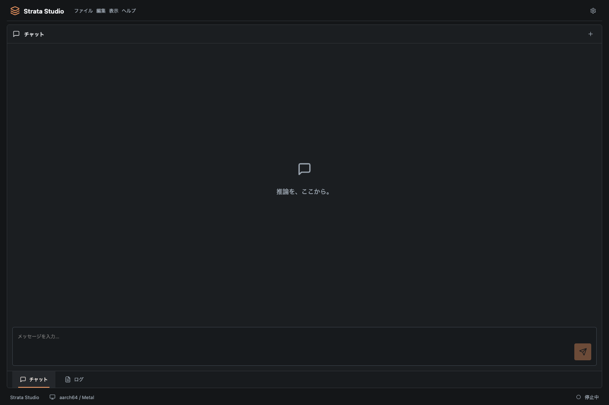

# Soliton



[English](README.md) · [日本語](README.ja.md)

面向Apple Silicon的Tauri 2应用与Rust API网关，支持Strata和vLLM-Apple。Rust统一管理会话、历史、日志和指标，推理引擎手动切换。

## 切换引擎

在「偏好设置 → 引擎 → 推理引擎」选择Strata或vLLM-Apple。切换会先停止当前受管引擎和子进程，再保存选择；请随后点击「启动」。会话生成、API响应或模型准备期间禁止切换。受管引擎不会同时驻留。独立手动启动的进程不受Soliton管理，请预先停止。

vLLM-Apple需要配置根目录中的`vLLM-apple/`、Python绝对路径、现有本地模型目录的绝对路径、MLX LM或vLLM-Metal，以及后端可执行文件的绝对路径。请先在vLLM-Apple准备兼容环境。Soliton不安装依赖或自动下载模型。移动虚拟环境后，可执行文件可能仍引用旧路径，必要时请修复或重建。MLX使用`default_model`，vLLM-Metal使用指定模型路径。仅在daemon报告`inference_ready`后启用聊天。

共用会话、历史、日志、内存历史和请求指标；新请求记录所用引擎。切换后会话作为新提示发送，不传递KV缓存。上下文、role和tools支持依模型而定。转发OpenAI API；仅Strata显示Anthropic `/v1/messages`，不为vLLM-Apple转换协议。

产品更名为Soliton，bundle ID为`dev.soliton.desktop`。新存储文件不存在时读取旧`dev.strata.studio/studio.json`，后续保存到新目录，保留原文件。独立服务器保留`.studio-state.json`及`STUDIO_*`环境变量。工作目录与引擎名称不变。

执行`npm run build`和`cargo build -p studio-server`后，可用`npm run test:engines`在18080端口进行协议fixture浏览器测试，无需模型或GPU。可通过`PLAYWRIGHT_CHROMIUM_EXECUTABLE`指定浏览器。真实模型质量、内存峰值和长期性能需另行验证。

根目录的`vLLM-apple/`保留为独立Git仓库，父仓库忽略该目录以避免重复登记。在其他机器上执行`git clone https://github.com/matsushibadenki/vLLM-apple.git vLLM-apple`后准备兼容环境。源代码和现有评估记录由该仓库自行管理。

## 启动

```sh
npm ci
npm run desktop
```

桌面应用自动启动`127.0.0.1:8080`上的API服务。不要同时运行独立服务器。

浏览器或无界面模式：

```sh
npm run build
cargo run -p studio-server --release
```

打开`http://127.0.0.1:8080`。

## 连接Strata

打开应用标志 →“偏好设置…”→“引擎”，填写Strata目录、已安装依赖的Python 3.10+解释器绝对路径，以及Strata安装生成的`strata-*.json`，然后点击“启动”。首次启动会检测Strata目录中的`.venv/bin/python`和现有配置。

选择“测试引擎”可在没有模型时验证API。模拟引擎的输出和日志速度不代表真实推理性能。

真实推理需要Metal可执行文件、模型文件和分词器。请参考[Strata Mac指南](Strata/docs/MAC.md)。偏好设置中“引擎”选项卡的下载图标可打开连接检查、配置选择和模型准备。确认容量、勾选下载选项并点击“准备模型”后才会开始下载。准备过程使用独立`.venv`，支持日志、停止和完成后自动应用配置，不会自动启动推理引擎。Studio不会自动下载大型模型。在32GiB开发Mac上，保留Strata默认SSD专家流式加载和内存保护。

Apple Silicon上会根据物理内存自动设置上下文与提示词缓冲区，并在模型准备、重新准备后以及启动前重新应用，保留已有的更小上限。32 GiB使用8K上下文、64个token的处理单元。参见[Mac内存策略](docs/MAC_MEMORY.md)。 偏好设置 → 引擎中可查看自动值和已应用值，选择“手动”可修改上下文、处理批量与macOS保留内存。运行时也可点击“应用并重启”，一次完成停止、保存和启动。“应用”用于停止状态下保存。重新准备后仍会保留。 引擎选项卡还实时显示Mac整体的已用与可用内存及更改前后的差值，包含可回收缓存和其他应用的影响。 内存趋势图可切换2、5、10分钟，对比Mac整体与Strata进程，并标记设置应用、启停及推理区间。聊天时持续记录，退出应用后清空。

点击应用标志可打开“关于、偏好设置、退出”。顶部的文件、编辑、视图和帮助菜单支持JSON对话导出、文本编辑和视图切换。偏好设置包含“通用（语言）、引擎、API”三个选项卡；主界面通过底部的“聊天／日志”选项卡切换。`⌘,`打开偏好设置，`⌘N`新建对话，`⌘1`／`⌘2`切换聊天／日志。

路径字段保留原生文件夹和文件选择器。Rust拥有配置、会话和生成中的文本，配置和会话在重启后保留。工作区标签页的顺序和选择也会保存，未发送文本属于临时界面交互状态。对话导出使用原生保存对话框选择位置。

## 本地模型发现

打开“偏好设置 → 引擎 → 本地模型”（文件夹搜索图标）会自动扫描，也可从“准备模型”窗口打开。搜索 Strata 默认位置、LM Studio、Unsloth Studio、Ollama 和自定义文件夹，同时读取已修改的模型目录、Unsloth HF 缓存设置与历史、`HF_HOME`／`HF_HUB_CACHE` 及 `OLLAMA_MODELS`。

自定义目录可通过路径或 Mac 原生文件夹选择器添加，最多保存32个。移除搜索位置不会删除文件。列表显示来源、路径、大小和格式，可按来源及名称筛选。Ollama 的无扩展名 GGUF 从 manifest 恢复模型名；HF 符号链接和相同物理文件会去重。

检测不保证推理兼容性，不验证架构、量化及分片完整性；加载仍需兼容的 Strata 配置。扫描本身不会修改模型。会显示不存在、不可读及达到限制的目录。上限为10万个条目、2,000个模型文件、16层深度和15秒遍历预算；大型目录请指定更具体的子目录。`GET /studio/models`需要认证，`?refresh=true`强制重新扫描，普通结果缓存30秒。`npm run test:models`验证界面；Rust 测试覆盖五类来源、配置覆盖、重复和循环链接及旧设置兼容性。来源链接见[英文README](README.md#local-model-discovery)。

## 选择并复用模型

在列表中选择模型，检查后点击“在 Strata 中使用”。若已有引用该文件的可用 Strata 配置，会直接应用配置；否则可准备当前 Metal 支持的 Qwen3.8-Flash-Next GSQ-RCO Q2_0、IQ3_XXS、IQ3_S，以及 Unsloth UD-Q4_K_XL、UD-Q5_K_XL、UD-Q6_K_XL。需要上游文件名和完整分片集合。

准备前检查架构、分片编号与数量、张量重复/缺失及文件边界，拒绝缺片、损坏或不支持的模型。通过链接复用原文件，不重新下载模型权重，也不修改其他应用的模型和完成标记。可能仍需获取工具/Python依赖、构建引擎并为派生模型包腾出空间；禁用可选 MTP 权重下载。支持日志、取消和成功后自动应用配置；失败不会转为下载模型。引擎通过“启动”按钮运行。`npm run test:reuse`和 Rust 测试验证复用流程、源文件不变和下载拦截；尚未验证大型真实模型的构建与推理。

## API与构建

复制偏好设置中“API”选项卡的会话密钥，使用`Authorization: Bearer`或`x-api-key`。OpenAI端点为`/v1/chat/completions`，Anthropic端点为`/v1/messages`。密钥在重启后更新。

```sh
npm run desktop:build -- --bundles app --no-sign
```

Release构建面向Apple Silicon。发布签名与公证需要Apple开发者凭据。

更多内容见[English README](README.md)、[架构](docs/ARCHITECTURE.md)和[路线图](docs/ROADMAP.md)。

对话自动保存。点击历史图标可搜索并继续对话；新建对话会保留原对话。删除前需确认，可通过文件菜单将当前对话导出为JSON。

偏好设置 → 通用中可设置对话及输入框的文字大小（12–32px），并切换浅色或深色模式。设置会自动保存，重启后保留。

展开回答的推理/工具调用及计量行，可查看推理文本、工具参数、单次请求延迟和上游报告的token数及速度。偏好设置 → API显示最近100条请求的计量；缺失值显示—。参见[推理与计量](docs/INFERENCE.md)。

底部标签页支持拖动、左右按钮及 Alt+←/→ 排序。点击向外箭头可将聊天／日志组浮动到独立窗口，点击停靠按钮或关闭浮动窗口即可返回。顺序和选中标签页由 Rust 共享并保存。参见[工作区操作](docs/WORKSPACE.md)。

停靠布局图标可将聊天和日志拆分为左右或上下独立组，或重新合并。也可将标签页拖到边缘／中央目标操作，调整分隔线并分别浮动各组。拆分布局在重启后恢复，窄窗口中自动纵向显示。浮动标签页可直接拖放到主工作区或另一个浮动窗口。边缘拆分，中央合并；保留目标窗口并自动关闭空的来源窗口。

## 推理测量

配置现有模型后，运行 `npm run benchmark:inference -- --start --output /tmp/strata-benchmark.json`，使用逐渐加长的合成检索输入，记录引擎报告的token数、耗时及Mac／引擎内存采样。不会下载模型或修改对话、设置；脚本启动的引擎会在结束时停止。参见[测量方法与限制](docs/BENCHMARKS.md)。

已适配Strata 0.2.1系列的 `9de04cd4`（源码版本0.1.46.3）。参见[兼容性与验证范围](docs/UPSTREAM_COMPATIBILITY.md)。

[vLLM-Apple证据验证与真实模型测试](docs/VLLM_APPLE.md)。

当前Gemma 2 2B已通过既有identity-bound证据机制，在Soliton.app中验证真实推理。具体环境及七天证据更新流程请参见上述文档。

当前Strata源码为0.2.4，Tauri为2.12.5。参见[依赖更新与验证范围](docs/DEPENDENCY_UPDATE_20261024.md)。旧0.2.1的真实推理结果不能认证新引擎。
