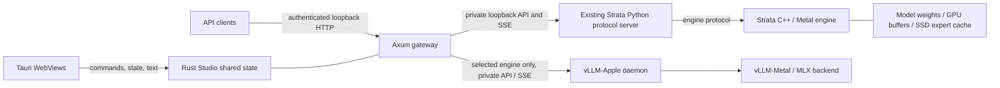

# Soliton architecture

## Inspected upstream

Local Strata revision: `296b59d2f73c8f04a805df29c2fa97655adace78`, engine version `0.1.44.1`. The upstream checkout remains unchanged.

| Directory                                                   | Role                                                                                               |
| ----------------------------------------------------------- | -------------------------------------------------------------------------------------------------- |
| `Strata/src`, `Strata/include/strata`                       | C++ host, artifacts, planning, prefill, speculative decoding, GPU backends                         |
| `Strata/metal`                                              | Separate macOS CMake project: Metal runtime, GPU kernels, compatibility layer, Apple Silicon setup |
| `Strata/serve/server.py`                                    | OpenAI/Anthropic/Responses protocol handling, request queue, engine lifecycle                      |
| `Strata/serve/frontend.py`                                  | Chat template and output parsing                                                                   |
| `Strata/serve/runconfig.py`                                 | Upstream run configuration semantics                                                               |
| `Strata/setup.py`, `Strata/metal/setup_mac.py`              | Runtime installation, native builds, model preparation, generated run configs                      |
| `Strata/tests`, `Strata/metal/tests`, `Strata/serve/test_*` | Existing engine, Metal, API regression suites                                                      |

## Runtime boundaries

`studio-core` owns Document, Settings, child process, bounded logs, gateway authentication, streamed conversation updates and atomic state saves. `studio-server` runs the same core without Tauri. `src-tauri` owns native windows and passes their operations to the shared core. `src` renders state and maintains only temporary interaction drafts.

The API server does not translate model formats or duplicate upstream sampling/tool-call behavior. `/v1/*` is forwarded to the existing protocol implementation. GUI chat uses `/studio/chat`, which updates Rust's conversation during each SSE delta and rejects concurrent document mutations. External API conversations remain caller-owned, as in the upstream API.

Apple Silicon inference stays in the upstream native Metal implementation; no GPU buffers or large frame data cross the Rust/JavaScript boundary. This workbench has no heavy image/canvas renderer, so it does not introduce an unused wgpu renderer. Future heavyweight visualization should be implemented in a Rust wgpu renderer with command/state-only IPC.

## Lifecycle and storage

The Python server and its engine run in a dedicated Unix process group. Stop/desktop exit sends SIGTERM, waits up to eight seconds, then kills the group if needed. Unexpected exit is reflected as offline. Python version/dependencies and config existence are checked before launch. A port occupied by another application is not silently reused.

The gateway is loopback-only and authenticated. Its public session key is separate from the private upstream key. The browser session bootstrap accepts only the gateway's own origin or the local Vite origin. No external-origin CORS access is granted. API key headers from clients are replaced by the private upstream key.

Settings and conversation are written atomically; Unix saved-state permissions are `0600`. The session key is not saved. In-flight generation and detached-window flags reset after restart. Logs retain at most 300 lines of 4096 characters; ordinary proxied request bodies are limited to 16 MiB. This is a local desktop application, with no cloud service dependency.

## Verification scope

Development hardware reports Apple Silicon (`aarch64`), 32 GiB unified memory, macOS 27.0.1. Rust core tests cover authentication, missing-model configuration, atomic save/reload and reset of transient flags. Browser E2E covers upstream mock lifecycle, Rust-owned streamed chat, OpenAI models/SSE, Anthropic JSON, authorization, offline response, languages and responsive widths. Native Tauri tests cover floating engine/API windows, docking, window-close restoration and mock chat. Real Q2_0 inference has now been verified on the M4 through native GUI chat and the API; extended accuracy/performance testing remains pending.

## Model preparation and workspace chrome

`preparation.rs` inspects Python and generated configs without importing or executing setup. The setup job is opt-in: model names are an allowlist, capacity is reviewed before launch, and `confirmed: true` is required. The job bootstraps an isolated `.venv` under the selected source root, verifies that it is not a shared environment, then execs the official `metal/setup_mac.py` with `--yes --setup --no-start --no-browser --vision no` and an explicit model/context/data directory. Inference startup and settings changes are locked while preparation runs. The process group supports interruption with a kill fallback. Completion applies the expected model config only when its engine and tokenizer paths exist; failure/cancellation preserve the previous config. Download/working-space numbers are estimates from the inspected upstream model definitions, not measured transfer or inference results. Optional expert copies can require more disk.

The main WebView displays a single Chat/Logs workspace with bottom tabs. Preferences groups General, Engine and API settings in a modal dialog. Menus support keyboard navigation, Escape, outside-click dismissal and viewport-aware placement. Selected tabs, menu focus, selection ranges and unsent text are temporary interaction state; settings and conversation remain in Rust. Native export snapshots the Rust conversation, opens a save picker and writes JSON; native Quit shuts down managed processes before app exit. Legacy floating-window and validated dock-geometry commands remain available for compatibility, but the main UI no longer exposes side docks.

Verification covers setup diagnostics and consent, three dialog languages, responsive preferences and menus, keyboard tab/menu navigation, editor selection/undo, JSON export, streamed mock chat and API compatibility. Real model download/build/inference has also been verified; see LOCAL_INFERENCE_VERIFICATION.md.

## Model inventory

`catalog.rs` owns location discovery and a 30-second Rust-side cache. `Settings.modelDirectories` defaults to an empty array when old saved settings are loaded. The authenticated `/studio/models` route serializes scans through a mutex and offloads filesystem work to the blocking pool. Source configuration and environment locations are inspected without importing another application's Python code; Unsloth's two HF location settings are queried via a read-only SQLite connection. Ollama model layers are identified from manifests and GGUF headers. Canonical directories prevent cycles; Unix device/inode identity collapses symlinks and hardlinks while retaining source labels. Traversal and output bounds prevent an unbounded WebView list; the UI initially renders 50 filtered results.

The inventory transfers paths, sizes, format and detection status, never weights. Scanning does not activate models; the separate local selection flow below performs preparation checks. Custom folder removal affects only Studio settings.

## Local selection and preparation

`local_model.rs` resolves existing configs or the six allowlisted upstream shard filename sets. The inventory preserves a logical `selectionPath` alongside canonical paths for HF symlinks. `local_validate.py` uses the selected Python and upstream GGUF header reader without network or tensor-data reads, with bounded reads/counts and a 30-second timeout. It checks architecture, split consistency, tensor count/uniqueness, known tensor byte geometry and file bounds. Preparation revalidates on confirmation and rejects changed source/Python settings before taking the lifecycle path.

Local inputs share `preparation.rs` lifecycle/process-group supervision. Source symlinks live under a fingerprinted Studio workspace. An in-memory Python adapter passes `--gguf-dir`, overrides completion checks only for those links, forbids non-tool/archive downloads, bypasses upstream data-file migration, and disables optional MTP fetching. Upstream files are unchanged. Generated pack/repack files and source-sidecars belong to the Studio workspace; original weights remain in their stores. Existing config activation is locked against engine/preparation activity; successful preparation applies its config without automatically starting inference. A local-job flag keeps the progress dialog at zero model download and prevents accidental fallback to the download workflow.

Fixtures cover missing/mixed/truncated shards, logical-to-physical links, unchanged sources, existing config activation, a supervised preparation that asserts the download guard and optional MTP suppression, and UI selection through completion in three languages. Real Q2_0 local-file preparation and inference have also been verified; see LOCAL_INFERENCE_VERIFICATION.md.

## Mac memory policy

`metal_policy.rs` owns capacity-based context and prompt-chunk limits. Preparation passes the profile context to upstream setup, then applies the policy atomically before accepting the generated Metal config. Startup reapplies it to imported or externally regenerated configs. Existing smaller limits and unrelated settings survive; invalid configs fail without replacement. The engine's arena and memory-reserve rules are unchanged. `/studio/inspect` exposes `metalProfile`; startup logs the effective values. See [policy table](MAC_MEMORY.md).

Preferences exposes `MemoryControls` in English, Japanese and Simplified Chinese. `Settings.metalMemory` stores auto/manual mode plus context, prompt chunk and macOS reserve. Rust validates ranges and rejects memory changes while a managed engine is running or preparation is busy. Both preparation arguments and post-setup/startup config application use the saved values. Config metadata tracks Studio-written values so switching back to auto removes a previous manual override. Snapshot `memoryTuning` separates automatic recommendations, the next launch preview and the running process's applied settings.

`applyMemoryRestart` accepts only memory settings, validates them before stopping, and serializes stop/save/start with the lifecycle mutex. Chat registers generation under that mutex so the operation refuses an active reply without interrupting it. Plain settings updates still cannot alter memory while running. Save failure restores previous settings and attempts recovery; startup failure reports that the new values remain saved.

`memory_usage.rs` owns a cached, system-wide Mach VM sample and a transient before-change reference. Snapshot `memoryUsage.current` reports total/used/available/free bytes and an epoch-millisecond timestamp; `beforeChange` is captured before the stop phase of apply/restart or a plain memory save. Sampling uses the upstream reclaimable-memory formula, one retained host right and no polling subprocess. Errors produce null, never fabricated zero readings. Comparison state stays in Rust across WebViews but is not persisted across app relaunch.

メモリ履歴は `serve` と同じライフタイムのRustサンプラーが約1秒ごとに更新する。ウインドウは履歴を所有せず、上限付きの数値列とイベントをSVGに描画する。推論リクエストのガードはストリーム終了・失敗・切断で区間を閉じる。

## Conversation library

`conversations.rs` owns active conversation identity, activity timestamps and archived message arrays within Rust `Document`. New Chat archives a non-empty active conversation; switching restores the chosen messages and archives the current ones. Empty drafts do not accumulate. Titles use the first user message (80 characters). `/studio/state` returns active messages and summary rows only; inactive bodies stay in Rust and the existing atomic storage file. Old single-conversation documents acquire a library identity on load without discarding their messages.

`newConversation`, `switchConversation` and `deleteConversation` actions use the Document write lock and reject generation in progress. Deleting the active conversation starts an empty one; the UI requires a second explicit click after its deletion notice. The library allows up to 50 conversations and caps combined message text at 64 MiB when archiving. Export the selected conversation through File before deleting it if needed. GUI chat requests include `conversationId`; stale-window submissions are rejected before appending messages. Legacy API clients without that field retain their current-active-conversation behavior.

Appearance lives in shared Rust Settings (`chatFontSize`, `theme`), with defaults 13 px/dark for old files. The `appearance` action validates partial updates without changing engine settings or generation state. WebViews apply semantic color tokens and `--chat-font-size` to conversation text and the composer; Tauri window theme follows the saved mode.

`inference.rs` incrementally parses OpenAI/Anthropic SSE and JSON, including CRLF and split UTF-8. It stores response-reported usage/timings separately from gateway-clock latency. Chat messages carry optional inference metadata (old files remain readable); API requests keep only metrics in a bounded shared 100-record deque. Completed, cancelled and failed streams remain distinguishable. Restoring an interrupted chat clears its running state and unknown final duration. See [inference display and metrics](INFERENCE.md).

Workspace tab order and selection are persisted in `Document.layout`. Atomic validated actions select or move tabs without replacing unrelated layout values. Tauri serializes float/dock operations, keeps one `panel-workspace` WebView, and clears its transient detach state on destruction. WebViews render the shared Rust conversation and logs. See [workspace](WORKSPACE.md).

Split docking adds an optional horizontal/vertical orientation and a bounded ratio to the persisted layout. Rust derives `workspaceGroups` so every workspace tab has exactly one home. Native identity-based split/merge commits topology and transient host membership atomically under the document lock. Browser-only action calls cannot reconcile native windows and still reject topology changes while groups float. Floating creation validates group membership under the document lock; each group has its own native window label and returns to its slot on close. WebViews preview divider movement locally and commit only the ratio, never document or frame data.

`Document.workspace_hosts` is a transient group-to-native-host map, skipped during persistence and exposed explicitly in snapshots. A stable host alias can render a renamed joined group or multiple split groups. Native drop commands derive their destination from the invoking Tauri WebviewWindow, validate its current membership, persist geometry and reconcile retired hosts under the native panel mutex. Empty generating sources are hidden and closed only after Rust marks generation finished; a native event forwards Cancel from the new view to the original stream owner. Standard HTML drag is enabled by disabling Tauri file-drop interception, with a namespaced text fallback for native pasteboard transport. Placeholder slots accept the same edge/center drop targets.

Upstream 0.2.x compatibility: local setup patches both the legacy Mac aliases and `strata_control.mac_fit`, isolates the four-argument data-folder API, and keeps optional MTP downloads disabled. Native memory walks descendants via `PROC_PPID_ONLY` and validates parent relationships because `serve.lifeline` gives the Metal engine its own process group. Source pin and verification limits are in [UPSTREAM_COMPATIBILITY.md](UPSTREAM_COMPATIBILITY.md).

## Multiple engines

`engine.rs` stores a backwards-compatible `strata` / `vllmApple` selection and separate vLLM-Apple settings. `switchEngine` holds the Rust lifecycle lock, rejects active GUI/API requests and preparation, stops/reaps the previous process tree, then persists the selection without starting a second engine. `start` launches only that selection. On macOS native descendants in separate process groups are tracked by PID and birth time; shutdown checks worker exit before permitting a new engine. vLLM-Apple launches through its reviewed CLI with compatibility and runtime probes intact, an explicit local model directory, separate ephemeral daemon/backend ports and a private token passed through the environment. Its model readiness requires `inference_ready`, not a successful control health response alone. No dependencies/models are downloaded by Soliton.

OpenAI chat/API streaming, cancellation, conversation storage and bounded request telemetry use the common Rust paths. Metrics add an optional engine field, preserving old history. MLX model routing uses `default_model`; vLLM-Metal uses the configured local path. The frontend owns temporary drafts only. Native process-memory telemetry works for either selected engine; Strata memory tuning and model preparation remain engine-specific. Anthropic requests are not translated to the vLLM-Apple OpenAI protocol.

Renamed desktop bundles use `dev.soliton.desktop`; when the new state does not exist, the previous sibling `dev.strata.studio/studio.json` is read and future writes target the new location. No original history is removed. Existing headless state paths and environment variables remain compatible.

### Qualified MLX candidates

VllmSettings adds backward-compatible `evidence` (empty by default) and `context` (1024 by default). The supervised command always supplies an explicit context and, when selected, forwards the qualification JSON to the existing daemon verifier with Metal tuning disabled. Soliton does not implement a second evidence validator or broaden the backend version matrix. The daemon validates the full identity, seven-day expiry, clean 30-minute report and workload bounds before constructing its backend process. Native QA can use the existing headless `STUDIO_STATE_PATH` override to isolate conversations; normal startup retains legacy-state migration. See [measured verification](VLLM_APPLE.md).

`inspectVllm` is an explicit, stopped-engine metadata diagnostic. It holds the same lifecycle lock, rejects active requests/preparation, and runs the selected local CLI's `inspect-model` command with context/concurrency and optional evidence unchanged. Rust bounds stdout/stderr and execution time, kills the owned process group on timeout, and exports only sanitized status/reason/architecture/memory estimates. The result is transient shared State, keyed by exact vLLM settings, cleared on a fresh attempt or settings change, and hidden after five minutes. No weights are loaded and a successful diagnostic does not replace startup verification.

Qualified MLX text requests additionally pass Rust's `token_budget` preflight in both gateway and GUI paths before any upstream request or history mutation. A bounded, timed, isolated backend-Python child loads only the local tokenizer/template with offline mode and remote code disabled. One CPU-only child is lazily retained per selected engine session. It uses bounded line frames and matching request IDs, never prompt/answer/count caches. Cancellation removes the in-flight worker from its Rust slot so a partial response cannot be reused; faults latch closed until stop/restart. File inventory/inode/size/mtime/ctime checks surround loading and every count. Stop/switch/settings changes reap it before proceeding; snapshots clean it up after backend exit under the lifecycle lock. Native SIGINT/SIGTERM now invoke ordered shutdown as well as Quit. Exact input tokens plus explicit requested output must fit `VllmSettings.context`; counting failures reject instead of falling back. This compensates for the current MLX server lacking `/tokenize` while the daemon can fall back to an unknown prompt count. No upstream runtime/executable changes or second resident model are introduced. The measured scope is single-candidate plain text; tools/custom templates/structured content are rejected rather than assigned guessed counts.

The measured Gemma 2 tokenizer has a bounded lightweight implementation: it loads the original serialized Hugging Face `tokenizers` engine and renders the original Jinja template with `ImmutableSandboxedEnvironment`, without importing Transformers/PyTorch/MLX. Selection requires exact SHA-256 matches for all four tokenizer/config/special-token files, the measured Transformers/tokenizers/Jinja versions, and absence of unknown model-root sidecars. Other serializations or versions use the existing offline, `trust_remote_code=False` AutoTokenizer implementation. Selection is independent of and never substitutes for backend startup qualification. File stamps still surround selection/loading and every count; an execution error remains fail-closed rather than switching implementations mid-frame. The pinned raw-completion path follows the actual Transformers 5 Gemma BOS postprocessor, not an interpretation of its config flag. Token-ID parity, malformed conversation refusal and serialized-file/sidecar/version fallback are checked by `scripts/token-counter-parity.py` using the real local tokenizer.

日本語: 検証済みGemmaの4ファイルのSHA-256と依存版が完全一致する場合だけ、元のtokenizers/Jinjaテンプレートを直接使います。不一致は従来のオフラインAutoTokenizer経路へ戻ります。起動時の互換性・証跡検査、毎回のファイル変更検出、異常時の拒否、単一計数プロセスとエンジン排他稼働は維持します。

简体中文：仅在已验证Gemma的四个文件SHA-256及依赖版本完全匹配时，直接使用原始tokenizers/Jinja模板。不匹配时使用原有离线AutoTokenizer。启动兼容性及证据检查、每次计数的文件变更检测、异常拒绝、单一计数进程和引擎互斥运行保持不变。

Qualified MLX counter preparation now starts when an authenticated `/health` response from the owned daemon reports `control_ready: true`. In the current upstream daemon this HTTP service is created only after compatibility/evidence/model validation; model loading runs asynchronously afterward. Rust rechecks the lifecycle lock, live child, private port/key and complete selected settings before spawning the same CPU-only counter. No synthetic prompt, protocol frame or count is sent. Preparation does not mark inference ready; real requests still use the existing exact bounded exchange and failure latch. Repeated snapshots reuse the same child, and a failed/dead counter cannot respawn until explicit stop/restart. Existing stop/switch/settings/crash/cancel cleanup applies unchanged.

The Rust-owned transient `startup` snapshot records `controlReadyObservedMs`, `counterSpawnedMs`, `inferenceReadyObservedMs` and their `modelLoadingObservedMs` difference, relative to daemon spawn. These are first polling observations, not exact upstream phase durations or cached compatibility approvals. Strata/offline snapshots have no startup object. API clients that do not poll state retain lazy counter initialization. The counter now consumes its tokenizer memory before the first chat while the qualified engine is selected; it remains one CPU-only process and is reaped before an engine switch.

日本語: 起動検査後の認証済み`control_ready`を確認した時点で、モデル読込と並行して計数プロセスを先行起動します。入力や計数結果は作らず、実要求の正確な計数・異常時拒否・再起動時の再検査は維持します。起動時間はRust共有状態に観測値として保持し、検査結果のキャッシュには使いません。初回チャット前からtokenizer分のメモリを保持する点がトレードオフです。

简体中文：确认启动检查后的已认证`control_ready`后，在模型加载期间提前启动计数进程，不构造输入或计数结果。真实请求仍执行准确计数、异常拒绝及重启重新检查。Rust共享状态记录启动阶段的观测时间，不缓存兼容性批准。代价是在首次聊天前就保留tokenizer内存。

Backend fingerprint path processing uses a reviewable [local upstream patch](../patches/README.md): macOS invokes the system strict `realpath` for every resolution and uses separator-bounded normalized POSIX containment. It does not retain path results, file digests or approvals. Full content reads, file mutation checks, isolated probe, inventory recheck and limits remain unchanged. Each returned native allocation is freed; missing/looping/inaccessible paths fail closed. Non-native fallback retains pathlib. Native canonical spelling can differ on case-aliased paths, and wrapper changes require fresh qualification regardless of matching backend content digests. The 2026-10-23 full certification binds this changed runtime and current environment. Settings retain the new private evidence path; the old report is preserved rather than edited.

日本語: パス解決はmacOSの厳密な標準APIへ置き換えますが、毎回の全内容検査・変更検出・上限・再走査を維持します。結果のキャッシュや古い証跡の書き換えは行いません。変更したruntimeと現在の環境を新しい30分証跡に結び付けています。

简体中文：路径解析改用macOS严格系统API，保留每次完整内容检查、变更检测、限制及重扫。不缓存结果、不改写旧证据；修改后的runtime及当前环境由新的30分钟证据绑定。

The 2026-10-24 measured M4/Gemma profile raises the selected total context to 4,096 using new identity-bound evidence; the generic default remains 1,024. The guarded activation script consumes passing real workload/startup-refusal reports and invokes the original full startup verifier before atomically changing only context/evidence preferences. It preserves documents, requires stopped preferences owners and stores original-byte backups. Thirty-minute short-text qualification and the separate near-limit repeated workload are reported separately. See [scope and memory measurements](BENCHMARKS.md#qualified-context-expansion--2026-10-24).

日本語: 4,096は実証済みの個別設定です。新規既定値は1,024を維持し、反映前も通常起動時も元の完全な証跡検査を実行します。会話や他の設定を変更せず、エンジンの同時常駐を許可しません。

简体中文：4096是此环境的实测配置；新环境默认仍为1024。应用配置前及正常启动时均执行原有完整证据检查，不修改会话和其他设置，也不允许两套引擎同时常驻。

The cache-memory workload samples backend-reported `prompt_tokens_details.cached_tokens` and native owned-tree RSS/engine physical footprint without changing backend cache policy. Missing accounting fails the measurement. Reuse loss after prefix churn is an observation consistent with eviction; it is not direct KV inventory or proof of physical memory release. Normal counter reuse still caches no request/answer/count data. The 2026-10-24 current environment adds `PYTORCH_ENABLE_MPS_FALLBACK=1`, so complete qualification was rerun rather than bypassing identity checks. An environment-only refresh at an existing certified 4,096 bound requires the prior valid identity, passing cache/lifecycle/boundary reports and the original full startup verifier; other identity changes require the full matrix. Documents and other preferences remain unchanged. [Results](BENCHMARKS.md#diverse-long-history-cache-memory--2026-10-24).
